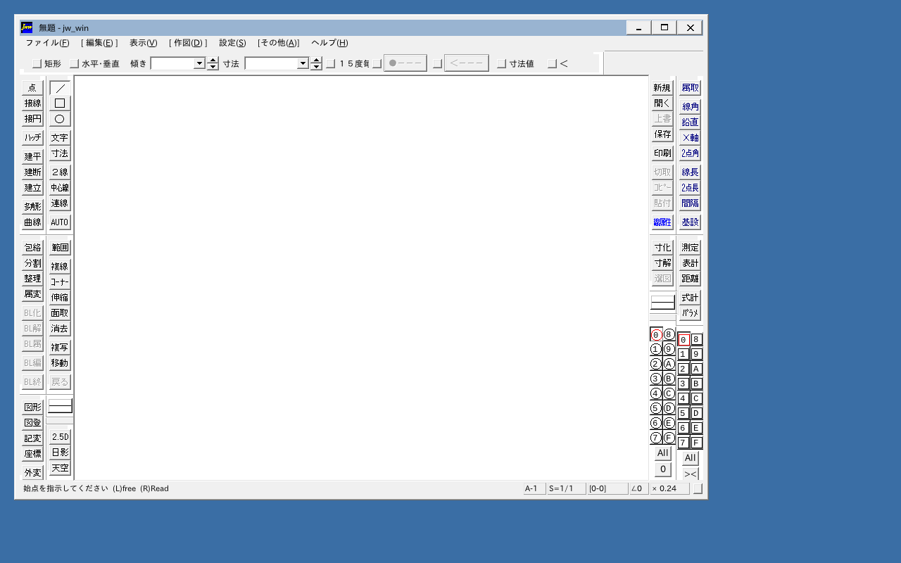
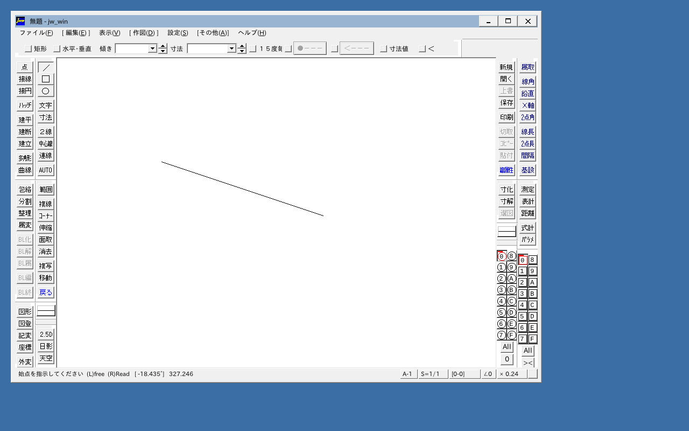

# jwcad_win_emu_cpp

Windows 版 **Jw_cad**（`orig/Jw_win.exe`、Jw_cad 10.03.6）を、改造せずにそのまま
x86 エミュレータで動かすためのリポジトリです。目標は WASM にしてブラウザで動かすこと。

* CPU・ローダ・kernel32 などは [x86_emu_cpp](https://github.com/yomei-o/x86_emu_cpp)
  （commit 18b9024）を `src/emu/` に取り込んだもの
* その上に **Win32 GUI 層**（`src/win32/`）を新しく書いている：user32（窓・メッセージ・
  メニュー・ダイアログ・標準コントロール）、gdi32（ソフトウェア描画）、レジストリ、
  コードページ 932 など
* MFC は Jw_win.exe に静的リンクされているのでゲストコードとしてそのまま動く
* comctl32 は **Wine 8.0 の comctl32.dll（LGPL）**をゲストとしてそのまま動かす
  （`dlls_dist/wine/`、出どころとライセンスは同じ場所の README.md）
* Direct2D / DirectWrite / GDI+ などは「無い」と答える（Jw_cad は GDI 描画に切り替わる）

**状態:** 本物の Jw_win.exe が起動し、作図・図面を開く・上書き保存・印刷（PDF／PNG）が
ネイティブとブラウザの両方で動く。全コマンドの確認はこれから。



## ブラウザで動かす

**<https://yomei-o.github.io/jwcad_win_emu_cpp/>**（Chrome / Edge / Firefox。初回は
サービスワーカーを入れるために一度だけ自動で再読み込みします）

エミュレータは Web Worker の中で動き、Jw_cad が入力を待つ間は `Atomics.wait` で
止まります。そのため SharedArrayBuffer が要り、GitHub Pages では `coi-sw.js` が
COOP/COEP ヘッダを付けています。画面は Worker が描いた ImageBitmap をページへ送っています。
設定（レジストリ）はブラウザの localStorage に残ります。



### ファイル

画面の下のパネルが Jw_cad から見える `C:\jww` の中身です（np2_wasm のデモと同じ作り）。
「ファイルを入れる」・ドラッグ＆ドロップで図面やテンプレートを入れ、DL で取り出せます。
入れたものと Jw_cad が保存したもの（● 印）はブラウザの IndexedDB に残り、次に開いたときも
そこにあります。「保存データを消す」で初期状態に戻ります。

### 印刷

プリンタは「PDF / PNG 出力」が一台だけあることになっています。Jw_cad の 印刷 →
プリンタの設定（用紙 A4〜A0・B4・B5・レター、縦／横、カラー）→ 印刷(L) で、
`C:\jww\印刷\<図面名>.pdf` と `.png` を書き出します。ブラウザでは PDF がそのまま
ダウンロードされ、PNG はパネルの「印刷」フォルダにあります。中身は GDI の描画を
用紙の大きさのビットマップに描いたもの（A4・A3 は 300dpi、A2 200、A1 150、A0 120dpi）です。

```sh
sh tools/build_wasm.sh            # -> jwemu.js / jwemu.wasm / jwemu.data（emsdk）
node tools/test_wasm.mjs          # node でヘッドレスに起動して tmp/wasm.png
node tools/web_test.mjs           # ヘッドレス Chrome で線・アップロード・開く・保存・印刷
```

## ビルドと実行（ネイティブ）

```sh
sh tools/build.sh                     # -> jwemu.exe（w64devkit の g++、低優先度）
./jwemu.exe orig/Jw_win.exe           # 窓で動かす
./jwemu.exe --headless --time 8000 --shot out.png orig/Jw_win.exe   # 画面を PNG に
```

## 権利

* `orig/` は Jw_cad の配布物そのまま（著作権は清水治郎・田中善文両氏、使用条件は
  `orig/Jw_win.txt`）
* `fonts/` は IPAex フォント（IPA Font License）、BIZ UDGothic・Liberation・Carlito（SIL OFL）
* `dlls_dist/wine/comctl32.dll` は Wine（GNU LGPL 2.1 以降、`dlls_dist/wine/COPYING.LIB`）
* `src/third_party/libtera/` は libtera の kanji.c（BSD）
* `src/third_party/stb_truetype.h`・`stb_image_write.h` は stb（パブリックドメイン / MIT）
* それ以外のソースは MIT（`LICENSE`）
